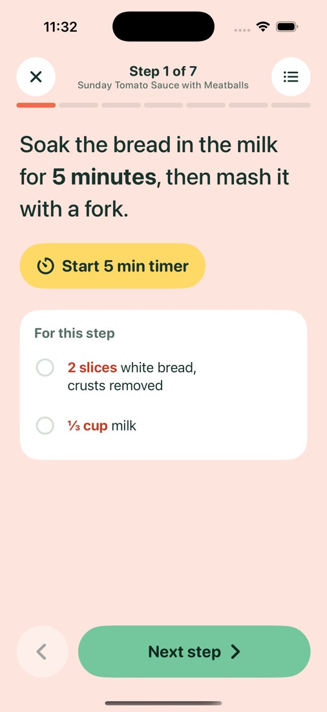
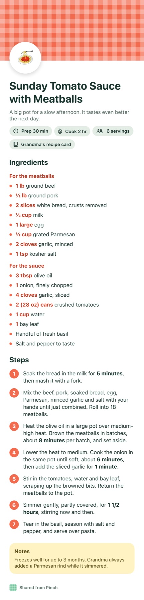
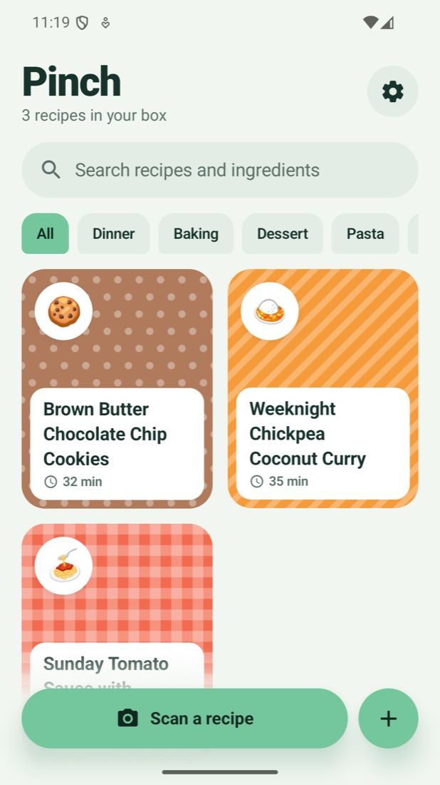
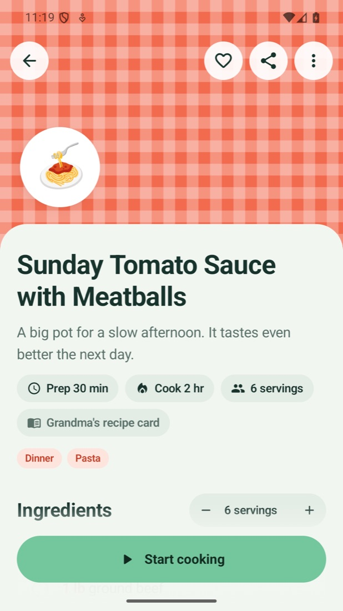

# Pinch

A recipe box for your phone. Photograph a recipe card, a cookbook page or a magazine clipping,
or paste a link to a recipe website, and Pinch reads it, sorts it into ingredients and steps, and
files it with its own patterned cover. Recipes live on the device and the app works offline.
Sign in to Pinch for automatic backup and AI reading, or connect your own server.

Two fully native apps with the same design and behavior:

- **iOS**: Swift and SwiftUI, iOS 18+, in [`ios/`](ios)
- **Android**: Kotlin and Jetpack Compose, Android 8.0+ (API 26), in [`android/`](android)

| Library | Recipe | Cook mode | Shared card |
| --- | --- | --- | --- |
|  |  |  |  |

| Android library | Android recipe | Android review after scanning |
| --- | --- | --- |
|  |  |  |

## What it does

- **Scan recipes, including ones split across pages.** iOS uses VisionKit's document camera;
  Android uses ML Kit's document scanner. Both find page edges, straighten the page, and take as
  many pages as you need. You can also pick photos, paste text, or type a recipe in, and add
  pages to a recipe later.
- **Read recipes with AI.** Sign in to Pinch, or add your own [OpenRouter](https://openrouter.ai) key under Self-hosting, and
  Pinch sends page photos (plus the phone's own OCR text as a hint), pasted text or web pages to
  DeepSeek V4.1 Flash, which returns the recipe as strict JSON. It reads handwriting, fixes
  misread words and keeps ingredient groups. See [AI reading](#ai-reading).
- **Add recipes from websites.** Paste a link (or share one to Pinch on Android). Pinch fetches the
  page, finds its schema.org recipe markup, and has the AI tidy it up with the page's headings and
  notes. Without a key it copies the site's recipe card directly. Sites that turn away plain
  requests with a bot check are loaded in a hidden browser view instead.
- **Read the text on the phone.** Apple Vision on iOS and ML Kit's bundled model on Android.
  A layout engine handles two-column cards, wrapped lines, and quantity columns before the
  parser splits out the title, headnote, servings, prep and cook times, ingredient groups,
  numbered or unnumbered steps, and notes. This is the offline fallback when there's no key or
  no connection. You review everything on a "Check it over" screen.
- **Find recipes with fuzzy search.** Typos ("chiken"), abbreviations ("chkn"), accents
  ("creme brulee"), plurals, and words from ingredients or steps all match. Results show the
  line that matched. Filter by favorites, "30 min or less", or tags.
- **Add a recipe banner.** In **Edit recipe → Cover**, add photos and tap the one you want for the banner.
  Photos appear in the recipe gallery. The banner also appears on the library card and in shared pictures.
- **Cook from a display built for the kitchen.** A recipe cover, big type, bold quantities,
  an ingredient checklist, a servings scaler that rounds the way a cook would (no "1⅛ eggs"),
  numbered steps with bold times and temperatures, and one-tap timers.
- **Cook mode.** One step at a time in large type with the screen kept on, the ingredients each
  step uses at the scaled amounts, timers that ring even from the background, and a small
  celebration at the end. Managed accounts use AI ingredient matching automatically. If you self-host,
  turn on **Match Cook Mode ingredients with AI** under **Self-hosting → Reading recipes**.
  Cook Mode uses on-device matching while it waits or if OpenRouter is unavailable.
- **Share as a picture.** Sends a picture of the recipe card through the normal share sheet.
  The recipient gets an image and doesn't need the app.
- **Cookbooks for your own collection.** Switch between **Cookbooks** and the **All recipes**
  grid using the icons beside Settings. A recipe can belong to several cookbooks. Organizing works
  offline, without an account; removing a cookbook keeps its recipes in your library.
- **Optional backup and cookbook sharing.** Sign in to Pinch or connect your own server to back up recipes,
  scanned pages and cookbooks. Invite viewers to read and cook, or editors to add and remove
  recipes. An editor's contribution automatically joins the owner's library. The owner's edits
  appear in shared cookbooks; other people can save independent copies. See [server setup](backend/README.md).
- **Focused settings.** Managed accounts sync and use AI automatically. Server and AI configuration live under **Self-hosting**.

On iPhones with Apple Intelligence (iOS 26+), offline scans also get an optional clean-up pass
with Apple's on-device model. It falls back to the built-in parser when the model isn't available.

## AI reading

Signing in to Pinch enables AI reading and Cook Mode ingredient matching through the managed
server. Self-hosting users can add their own OpenRouter key under **Self-hosting → Reading recipes**.
Their device connects directly to OpenRouter and keeps the key in the iOS Keychain or encrypted
with Android Keystore.

- **Model:** `deepseek/deepseek-v4.1-flash` (vision and text), with a strict JSON schema,
  reasoning off and temperature 0. OpenRouter is asked to route only to providers that support
  all of that, and Pinch retries once with plain JSON mode if none can take the request.
- **What gets sent:** the photos, text or page content being imported, or the ingredients and
  directions of the recipe opened in Cook Mode. Page photos are resized to 2000 px JPEGs.
- **Fallbacks:** offline, out of credit, or any other failure falls back to the on-phone reader,
  and the review screen says why. Websites without recipe markup need AI reading.

The prompt, schema and response cleanup live in `RecipeAI.swift` and `RecipeAI.kt`; the HTTP
clients are `OpenRouter.swift` and `OpenRouter.kt`. Website scraping is `WebRecipeImporter`
on both platforms.

## Support

For help with Pinch or Pinch Managed, email Whatado at [jaredclambert@gmail.com](mailto:jaredclambert@gmail.com).
For a self-hosted account, contact the operator of your server for help with that account or its backups.

## Running the apps

### iOS

Requires Xcode 26 or later.

1. Open `ios/Pinch.xcodeproj`.
2. For a physical device, copy `ios/Config/Local.xcconfig.example` to `ios/Config/Local.xcconfig`
   and set your bundle ID and development team. The simulator needs no setup.
3. Run the **Pinch** scheme.

The project is generated from `ios/project.yml` with [XcodeGen](https://github.com/yonaskolb/XcodeGen).
After adding or moving files, run `xcodegen generate` in `ios/`.

```bash
cd ios && xcodebuild test -project Pinch.xcodeproj -scheme Pinch -destination 'platform=iOS Simulator,name=iPhone 17'
```

The simulator has no camera, so the scan button becomes **Add from photos** there. Debug builds
also accept these launch arguments: `-seedSamples` (adds sample recipes),
`-importPages /path/a.jpg,/path/b.jpg` (runs the scan flow on image files),
`-importURL https://…` (runs the website flow) and `-PinchForceWebView YES` (always loads
websites in the hidden browser view).

### Android

Requires Android Studio (or JDK 17+ with the Android SDK, platform 36).

1. Open the `android/` folder in Android Studio.
2. Run the **app** configuration.

```bash
cd android && ./gradlew testDebugUnitTest assembleDebug
```

To update an older development install in place, add
`-PpinchApplicationId=com.example.pinch`. Normal builds use `com.whatado.pinch`.

Debug builds accept `--ez seedSamples true`, `--es importPages /path/a.jpg,/path/b.jpg`,
`--es importUrl https://…` and `--ez forceWebView true` as intent extras. Android also shows up as
a share target: share a recipe screenshot, copied text or a link from your browser to
**Save to Pinch**.

ML Kit's document scanner is delivered by Google Play services on first use. Until it's on the
phone, **Scan a recipe** opens the regular camera instead, so scanning works offline from day one.

## Publishing

Configure iOS signing in `ios/Config/Local.xcconfig` or Android signing in
`android/keystore.properties` before making a store build. Both paths have examples in the
repository. The [privacy policy](docs/privacy-policy.md) covers local, managed, and self-hosted use.

## ChatGPT and Codex plugin

The [Pinch plugin](docs/plugin/README.md) adds private recipe search, reading,
saving, favorites, and a recipe browser in ChatGPT's sidebar or beside a chat.
It connects through OAuth to the same server account as the mobile apps.
The implementation and development ZIP are ready for local testing; public
deployment, publisher verification and OpenAI review are still required.

## Self-hosted backup & sharing

Run the included [Pinch Server](backend/README.md) with Docker Compose. It uses SQLite and a
persistent volume, with optional automatic HTTPS through Caddy. In either app, open
**Settings → Account → Use your own server** and connect with your server address and account, or open a cookbook
invitation to join and create an account. Tap the **Add to cookbook** icon beside Share on a recipe, or **Add recipes**
inside a cookbook. In cookbook details, invite people as **Viewer** or **Editor** and manage access.
Shared recipes include notes and scanned pages. New contributions reach the owner's library
on the next sync; sync runs every 30 seconds while the app is active as well as after edits.

This experience requires the updated backend. Startup migrates existing groups to cookbooks,
preserving members, invitation links and the previously shared contents. Existing members become
editors. Old shared snapshots are retained without publishing later private edits. Update all
phones together: old clients receive an update-required message when opening a migrated group.

## How it's put together

| | iOS | Android |
| --- | --- | --- |
| UI | SwiftUI | Jetpack Compose + Material 3 |
| Text recognition | Vision (`VNRecognizeTextRequest`) | ML Kit Text Recognition (bundled model) |
| AI reading | Managed Pinch server or OpenRouter over `URLSession` | Managed Pinch server or OpenRouter over `HttpURLConnection` |
| Websites | `URLSession`, falling back to a hidden `WKWebView` | `HttpURLConnection`, falling back to a hidden `WebView` |
| Page capture | VisionKit document camera, PhotosPicker | ML Kit document scanner, camera, Photo Picker |
| Storage | One JSON file per recipe in Application Support | One JSON file per recipe in app files |
| Server sync | HTTPS via `URLSession`, session in Keychain | HTTPS via `HttpURLConnection`, session encrypted with Android Keystore |
| Share image | `ImageRenderer` → PNG → `ShareLink` | Off-screen Compose → `GraphicsLayer` → PNG → share sheet |
| Timers | Local notifications | Exact alarms (when allowed) + notification |

The parser, layout engine, quantity scaling, duration detection, search and cover suggestions
are written twice, line for line, and covered by matching test suites on each platform
(`ios/PinchTests`, `android/app/src/test`) so the two apps read recipes the same way.

### Design

The look borrows from vintage kitchenware: an enamel-white canvas, jadeite green for actions,
deep pine ink, cherry only for favorites and timers, and butter yellow for notes and timer
buttons. Every recipe gets a patterned cover (gingham, stripes, dots, waves or tiles) in one of
ten produce colors, with an emoji sticker chosen from its title and ingredients. You can change
any of these in the editor. Light and dark mode are both supported.
