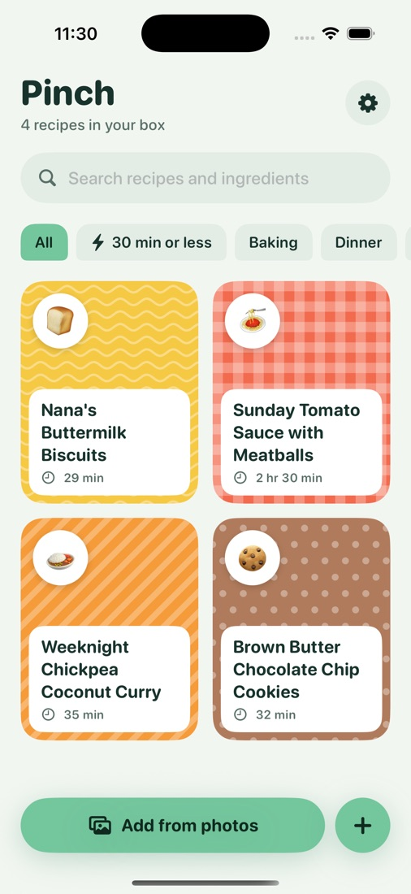
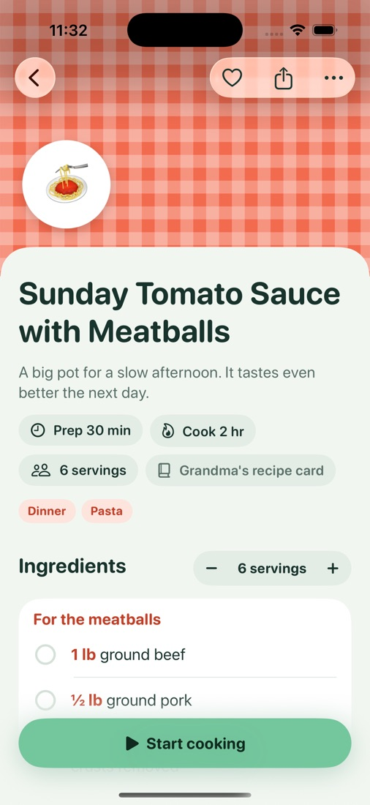
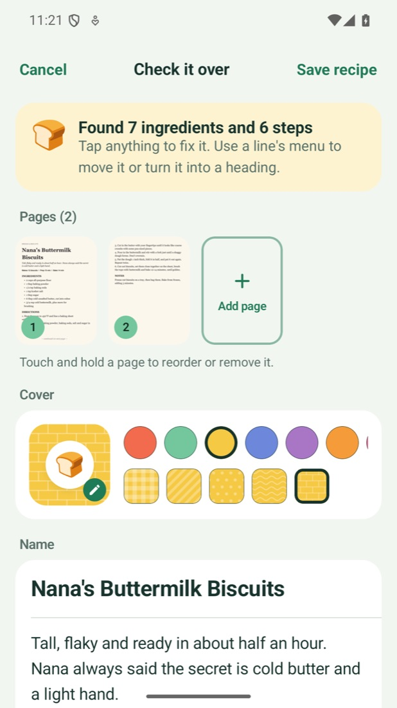

# Pinch

A recipe box for your phone. Photograph a recipe card, a cookbook page or a magazine clipping,
or paste a link to a recipe website, and Pinch reads it, sorts it into ingredients and steps, and
files it with its own patterned cover. Recipes live on the device and the app works offline.
AI reading (with your own OpenRouter key) and Google Drive backup are both optional.

Two fully native apps with the same design and behavior:

- **iOS**: Swift and SwiftUI, iOS 18+, in [`ios/`](ios)
- **Android**: Kotlin and Jetpack Compose, Android 8.0+ (API 26), in [`android/`](android)

| Library | Recipe | Cook mode | Shared card |
| --- | --- | --- | --- |
|  |  |  |  |

| Android library | Android recipe | Android review after scanning |
| --- | --- | --- |
|  |  |  |

## What it does

- **Scan recipes, including ones split across pages.** iOS uses VisionKit's document camera;
  Android uses ML Kit's document scanner. Both find page edges, straighten the page, and take as
  many pages as you need. You can also pick photos, paste text, or type a recipe in, and add
  pages to a recipe later.
- **Read recipes with AI.** Add your own [OpenRouter](https://openrouter.ai) key in Settings and
  Pinch sends page photos (plus the phone's own OCR text as a hint), pasted text or web pages to
  DeepSeek V4.1 Flash, which returns the recipe as strict JSON. It reads handwriting, fixes
  misread words and keeps ingredient groups. See [AI reading](#ai-reading).
- **Add recipes from websites.** Paste a link (or share one to Pinch on Android). Pinch fetches the
  page, finds its schema.org recipe markup, and has the AI tidy it up with the page's headings and
  notes. Without a key it copies the site's recipe card directly. Sites that turn away plain
  requests with a bot check are loaded in a hidden browser view instead.
- **Read the text on the phone.** Apple Vision on iOS and ML Kit's bundled model on Android.
  A layout engine handles two-column cards, wrapped lines, and quantity columns before the
  parser splits out the title, headnote, servings, prep and cook times, ingredient groups,
  numbered or unnumbered steps, and notes. This is the offline fallback when there's no key or
  no connection. You review everything on a "Check it over" screen.
- **Find recipes with fuzzy search.** Typos ("chiken"), abbreviations ("chkn"), accents
  ("creme brulee"), plurals, and words from ingredients or steps all match. Results show the
  line that matched. Filter by favorites, "30 min or less", or tags.
- **Cook from a display built for the kitchen.** A patterned cover, big type, bold quantities,
  an ingredient checklist, a servings scaler that rounds the way a cook would (no "1⅛ eggs"),
  numbered steps with bold times and temperatures, and one-tap timers.
- **Cook mode.** One step at a time in large type with the screen kept on, the ingredients each
  step uses at the scaled amounts, timers that ring even from the background, and a small
  celebration at the end.
- **Share as a picture.** Sends a picture of the recipe card through the normal share sheet.
  The recipient gets an image and doesn't need the app.
- **Optional Google Drive sync.** Backs up to a **Pinch Recipes** folder in your own Drive and
  syncs between phones, iPhone and Android alike, since both apps share one
  [file format](docs/recipe-format.md).

On iPhones with Apple Intelligence (iOS 26+), offline scans also get an optional clean-up pass
with Apple's on-device model. It falls back to the built-in parser when the model isn't available.

## AI reading

Pinch has no server and no key of its own. Each person pastes their own OpenRouter key into
Settings; it's checked against OpenRouter, then kept in the iOS Keychain (this device only) or
encrypted with an Android Keystore key (left out of backups). It is never synced or logged.

- **Model:** `deepseek/deepseek-v4.1-flash` (vision and text), with a strict JSON schema,
  reasoning off and temperature 0. OpenRouter is asked to route only to providers that support
  all of that, and Pinch retries once with plain JSON mode if none can take the request.
- **Cost:** roughly $0.30 per million input tokens and $1.20 per million output tokens, so a
  recipe costs a fraction of a cent. Settings shows what the key has spent.
- **What gets sent:** only the photos, text or web page being added. Page photos are resized to
  2000 px JPEGs. Nothing is sent without a key.
- **Fallbacks:** offline, out of credit, or any other failure falls back to the on-phone reader,
  and the review screen says why. Websites without recipe markup need a key.

The prompt, schema and response cleanup live in `RecipeAI.swift` and `RecipeAI.kt`; the HTTP
clients are `OpenRouter.swift` and `OpenRouter.kt`. Website scraping is `WebRecipeImporter`
on both platforms.

## Running the apps

### iOS

Requires Xcode 26 or later.

1. Open `ios/Pinch.xcodeproj`.
2. For a physical device, copy `ios/Config/Local.xcconfig.example` to `ios/Config/Local.xcconfig`
   and set your bundle ID and development team. The simulator needs no setup.
3. Run the **Pinch** scheme.

The project is generated from `ios/project.yml` with [XcodeGen](https://github.com/yonaskolb/XcodeGen).
After adding or moving files, run `xcodegen generate` in `ios/`.

```bash
cd ios && xcodebuild test -project Pinch.xcodeproj -scheme Pinch -destination 'platform=iOS Simulator,name=iPhone 17'
```

The simulator has no camera, so the scan button becomes **Add from photos** there. Debug builds
also accept these launch arguments: `-seedSamples` (adds sample recipes),
`-importPages /path/a.jpg,/path/b.jpg` (runs the scan flow on image files),
`-importURL https://…` (runs the website flow) and `-PinchForceWebView YES` (always loads
websites in the hidden browser view).

### Android

Requires Android Studio (or JDK 17+ with the Android SDK, platform 36).

1. Open the `android/` folder in Android Studio.
2. Run the **app** configuration.

```bash
cd android && ./gradlew testDebugUnitTest assembleDebug
```

Debug builds accept `--ez seedSamples true`, `--es importPages /path/a.jpg,/path/b.jpg`,
`--es importUrl https://…` and `--ez forceWebView true` as intent extras. Android also shows up as
a share target: share a recipe screenshot, copied text or a link from your browser to
**Save to Pinch**.

ML Kit's document scanner is delivered by Google Play services on first use. Until it's on the
phone, **Scan a recipe** opens the regular camera instead, so scanning works offline from day one.

## Google Drive

Connecting Drive needs a free OAuth client from Google Cloud: one iOS client and one Android
client in the same project. There's no server. See
[docs/google-drive-setup.md](docs/google-drive-setup.md).

## How it's put together

| | iOS | Android |
| --- | --- | --- |
| UI | SwiftUI | Jetpack Compose + Material 3 |
| Text recognition | Vision (`VNRecognizeTextRequest`) | ML Kit Text Recognition (bundled model) |
| AI reading | OpenRouter over `URLSession`, key in Keychain | OpenRouter over `HttpURLConnection`, key encrypted with Android Keystore |
| Websites | `URLSession`, falling back to a hidden `WKWebView` | `HttpURLConnection`, falling back to a hidden `WebView` |
| Page capture | VisionKit document camera, PhotosPicker | ML Kit document scanner, camera, Photo Picker |
| Storage | One JSON file per recipe in Application Support | One JSON file per recipe in app files |
| Drive sign-in | OAuth 2.0 + PKCE via `ASWebAuthenticationSession`, Keychain | Google Identity `AuthorizationClient` |
| Share image | `ImageRenderer` → PNG → `ShareLink` | Off-screen Compose → `GraphicsLayer` → PNG → share sheet |
| Timers | Local notifications | Exact alarms (when allowed) + notification |

The parser, layout engine, quantity scaling, duration detection, search and cover suggestions
are written twice, line for line, and covered by matching test suites on each platform
(`ios/PinchTests`, `android/app/src/test`) so the two apps read recipes the same way.

### Design

The look borrows from vintage kitchenware: an enamel-white canvas, jadeite green for actions,
deep pine ink, cherry only for favorites and timers, and butter yellow for notes and timer
buttons. Every recipe gets a patterned cover (gingham, stripes, dots, waves or tiles) in one of
ten produce colors, with an emoji sticker chosen from its title and ingredients. You can change
any of these in the editor. Light and dark mode are both supported.
