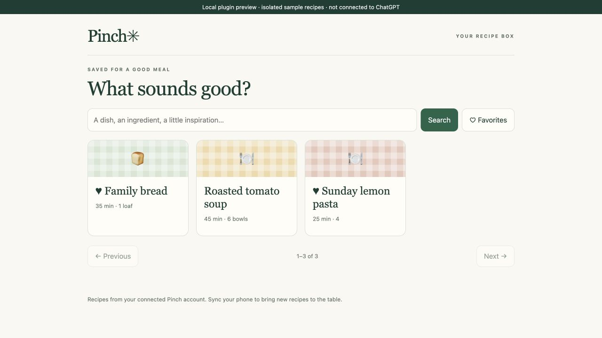
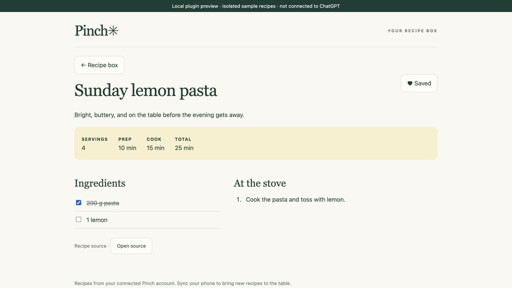

# Pinch for ChatGPT and Codex

The plugin connects ChatGPT or Codex to a Pinch server account. It includes five
MCP tools, an interactive recipe box, and a skill for cooking and meal planning.
Recipes saved through the plugin use the same schema and database as mobile sync.

The development package targets localhost. See [Build the package](#build-the-package)
for the configuration needed to deploy it for a hosted client.

The implementation follows OpenAI's current
[portable plugin format](https://developers.openai.com/plugins/build/plugins),
[MCP OAuth requirements](https://developers.openai.com/plugins/build/auth),
[MCP Apps UI guidance](https://developers.openai.com/plugins/build/chatgpt-ui), and
[new sidebar/conversation extensions](https://developers.openai.com/plugins/build/extensions).
Public publication requires the
[submission and review process](https://developers.openai.com/plugins/deploy/submission).

## What is included

| Tool | Behavior |
| --- | --- |
| `search_recipes` | Search titles, ingredients, steps and tags; filter favorites or an exact tag; paginate summaries. |
| `get_recipe` | Read a recipe's ingredients, directions, notes, times and source from the connected account. |
| `save_recipe` | Create a private recipe with a stable request ID for safe retries. |
| `set_recipe_favorite` | Set an explicit favorite value and sync it to phones. |
| `open_recipe_library` | Browse in an MCP Apps iframe, the sidebar, or a conversation panel. |

The UI uses the standard MCP Apps JSON-RPC bridge, safe text rendering, a
self-contained resource with no external script/network dependencies, and the
OpenAI `global` and `thread` entrypoints. It has search, pagination, favorites,
recipe directions, and an ingredient checklist. Tools remain usable without UI.

Only server-synced recipes are visible. The plugin does not expose photo bytes,
raw OCR, cooking history, account management, deletion, or group-sharing actions.
It does not call an AI API or require an OpenAI/OpenRouter API key. The selected
ChatGPT or Codex model handles conversation tasks such as meal planning.

## Run locally

From `backend/`:

```sh
uv sync --frozen
export PINCH_PUBLIC_URL=http://localhost:8787
uv run uvicorn server:app --host 127.0.0.1 --port 8787 --no-access-log
```

Use an existing account or configure account registration as described in the
[server setup](../../backend/README.md). The package's `mcp.json` points to this
local endpoint. A desktop MCP client can connect locally. ChatGPT's hosted
connection needs an Internet-accessible HTTPS endpoint.

For a local OAuth test client, put its **exact callback URI** in
`PINCH_OAUTH_REDIRECT_URIS` before startup. ChatGPT's stable and per-connection
callbacks are supported automatically. Do not add wildcard callbacks.

### Preview without touching personal data

```sh
cd backend
uv run python tests/plugin_preview.py
```

Open `http://127.0.0.1:8788`. This development-only preview creates a temporary
database, obtains OAuth tokens through the real login flow, and forwards UI
requests to the real MCP tools. Its banner identifies the sample data and the
simulated host. Do not deploy the preview harness.





## Deploy the server

Use the existing single-node Docker/Caddy deployment with a persistent local disk.
This SQLite service is not designed for ephemeral serverless storage or replicas.

In `backend/.env`, configure:

```dotenv
PINCH_DOMAIN=your-real-domain
PINCH_PUBLIC_URL=https://your-real-domain
PINCH_REGISTRATION_KEY=your-private-registration-key
```

Set real values, keep `.env` out of source control, and start
`docker compose --profile https up -d --build`. Configure the phones to sync to
that same server. An empty `PINCH_PUBLIC_URL` disables all plugin routes while
preserving the existing mobile API. New OAuth tables are added without changing
existing recipe records.

OAuth discovery and transport:

- MCP endpoint: `/mcp`
- Authorization server: `/.well-known/oauth-authorization-server`
- Protected resource: `/.well-known/oauth-protected-resource/mcp`
- Dynamic public client registration: `/register`, authentication method `none`
- Authorization: `/authorize`; user login and consent: `/plugin/connect`
- Token exchange/refresh: `/token`; disconnect/revocation: `/revoke`
- Scopes: `recipes:read`, `recipes:write`

The flow requires S256 PKCE, exact resource binding and registered redirects.
Consent requires a browser-bound CSRF token and matching Origin. OAuth tokens
are separate from mobile sessions; only hashes of codes and access/refresh tokens
are stored. Access tokens last one hour. Refresh tokens rotate on use and expire
90 days after linking. Revocation, account deletion and operator password reset
invalidate the relevant credentials. Persistent rate limits and the existing
per-account storage quota remain enforced.

Only OpenAI HTTPS callbacks and exact operator-configured callbacks can register.
Each server permits at most 1,000 registered OAuth clients. Login limits retain
the backend's conservative shared-proxy behavior. Review capacity and rate limits
before offering the service beyond a small family/community installation.

## Build the package

From the repository root:

```sh
python3 scripts/package_plugin.py
```

This produces a reproducible development ZIP. The source is `plugins/pinch/`;
it contains a portable `plugin.json`, `mcp.json`, an icon, and the `recipes` skill.
The ZIP contains no server code, local database, private keys, or credentials.

For a release, supply the actual deployed origin and public listing URLs:

```sh
python3 scripts/package_plugin.py --release \
  --server https://YOUR_SERVER \
  --website https://YOUR_WEBSITE \
  --support https://YOUR_SUPPORT_PAGE \
  --privacy https://YOUR_PRIVACY_POLICY \
  --terms https://YOUR_TERMS \
  --support-email YOUR_PUBLIC_SUPPORT_EMAIL \
  --demo https://YOUR_REVIEW_VIDEO
```

Replace every uppercase value. This command refuses missing fields, non-HTTPS
URLs, loopback/example/test hosts, credential-bearing URLs, and server subpaths.
It writes `dist/pinch-1.0.0.zip` without changing the local development package.
URL validation does not prove the pages are accessible or publisher details are
correct; verify them before uploading.

## Submit and publish

1. Complete individual or business verification in
   [OpenAI organization settings](https://platform.openai.com/settings/organization/general).
   The package currently names **Whatado, LLC**, matching Pinch's existing app
   materials; select a matching verified identity or update the package publisher.
2. Deploy the backend, check `/health`, and test OAuth and the tools from ChatGPT
   developer mode. Choose OAuth with dynamic registration and public-client
   authentication (`none`). No client secret is needed.
3. Provide a public privacy policy covering the plugin data flows described in
   [Pinch's policy](../privacy-policy.md). Fill its existing support-email field.
   Supply the product/support pages and terms of service.
4. Create a dedicated reviewer account with sample recipes. Use the five positive
   and three negative cases in `plugins/pinch/plugin.json`. Run all cases in the
   real ChatGPT connection and record a walkthrough; local tests alone do not
   establish hosted-client behavior. Enter reviewer credentials only in the
   portal's private review fields, never in the ZIP.
5. Build the release ZIP and upload it in
   [OpenAI Plugins](https://platform.openai.com/plugins). Connect the MCP server.
   Set `PINCH_OPENAI_CHALLENGE` to the exact domain-verification token supplied
   by the portal and restart the server. It is served as plain text from
   `/.well-known/openai-apps-challenge`. Preserve any challenge used by a different
   plugin; choose a separate eligible hostname if needed.
6. Resolve metadata, skill and tool scan findings. Submit for review with the
   review materials and required attestations. When approved, select **Publish
   plugin**. Uploading, submitting, and publishing are separate statuses.

## Verification

```sh
cd backend
uv run pytest -q
```

The suite checks the existing mobile API plus OAuth discovery, PKCE, CSRF,
redirect/resource/client binding, rotation, revocation, expiry, restart
persistence, account isolation, read-only scopes, write quotas, login limits,
concurrent retry safety, tombstones, pagination and preservation of mobile fields.

The local preview exercises search, navigation, favorite writes and ingredient
checkboxes against the same MCP handlers used by hosted clients.
